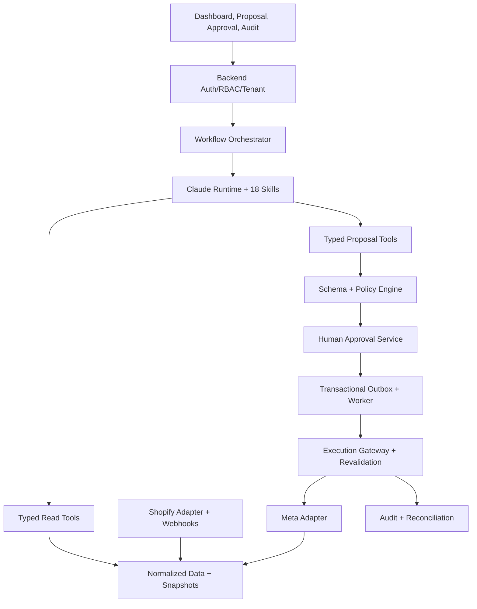

# POD AI Facebook Ads Manager — Đặc tả kỹ thuật 18 Skills

Phiên bản 1.0 · 21/10/2026 · Shopify · Claude Skills · Meta Marketing API · Chế độ approval

## 1. Mục tiêu và phạm vi

Xây dựng trợ lý AI quản trị vòng đời Facebook/Instagram Ads cho cửa hàng Print-on-Demand: hiểu sản phẩm, tính lợi nhuận, nghiên cứu, lập kế hoạch, sáng tạo, thiết lập, đo lường, tối ưu và báo cáo. Claude phân tích và đề xuất; con người phê duyệt; backend kiểm tra và thực thi. Không hứa lợi nhuận hoặc khả năng được Meta chấp thuận.

Đây là đặc tả xây dựng, không phải lệnh chạy quảng cáo. Mặc định `EXECUTION_MODE=mock`, `LIVE_WRITES_ENABLED=false`. Không gọi API ghi thật, không dùng token thật trong CI, không tự bật campaign hoặc tăng ngân sách. Tạo đối tượng PAUSED trên Meta vẫn là thay đổi thật và cần duyệt.

Bối cảnh hội thoại khôi phục được: POD, Shopify, phạm vi full, mức tự động hóa approval. Các câu trả lời cũ chỉ còn mã tham chiếu; bộ 18 Skills dưới đây được định nghĩa mới cho nhất quán, không khẳng định trùng danh sách cũ.

Baseline: Shopify chỉ đọc; Meta đọc và ghi có duyệt qua gateway. Sửa storefront/giá/sản phẩm, gửi CAPI, upload danh sách khách hàng và gửi email/Slack không nằm trong quyền mặc định. Nếu mở rộng phải có thiết kế, consent và approval riêng.

## 2. Kiến trúc và ranh giới quyền



- Stack đề xuất: TypeScript strict, Next.js UI, Fastify hoặc tương đương, PostgreSQL, queue/Redis nếu cần, object storage cho assets. Chốt bằng ADR; không bắt buộc microservices cho MVP.
- Skill là gói hướng dẫn/tài nguyên, không phải daemon, scheduler hoặc lớp bảo mật. Claude Code dùng để phát triển/chạy thử; runtime production phải chọn rõ Claude API/Agent SDK và cơ chế nạp Skills tương thích. Không giả định `.claude/skills` tự chạy trên mọi runtime.
- Backend gắn tenant/principal từ session xác thực. Bỏ qua tenant hoặc role do mô hình tự khai báo. Worker ghi là thành phần duy nhất có token ghi Meta.
- Expose tools qua MCP hoặc function calling có schema. Không cho runtime phân tích HTTP tùy ý, SQL tùy ý, shell hoặc credential ghi.
- Mô tả sản phẩm, web, creative, tài liệu tải lên và phản hồi tool là dữ liệu không tin cậy; không được thay policy, quyền tool hoặc approval.
- Thiết kế hỗ trợ nhiều store/account: mọi record, cache, queue job, object và audit đều có tenant boundary, dù MVP chỉ một store.

### Cấu trúc repository

```text
.claude/skills/<slug>/SKILL.md
.claude/skills/<slug>/references/
.claude/skills/<slug>/scripts/      # chỉ khi cần xử lý xác định
.claude/skills/<slug>/evals/        # quy ước eval riêng của dự án
apps/{web,api,worker}/
packages/{contracts,domain,policy}/
packages/adapters/{meta,shopify,claude}/
fixtures/
tests/{unit,contract,integration,e2e,security}/
docs/{adr,runbooks,api-capabilities}/
CLAUDE.md
.env.example
```

## 3. Tiêu chuẩn mỗi Skill

Mỗi thư mục có `SKILL.md`, YAML frontmatter `name`, `description`; tên slug duy nhất. Description nêu khi dùng và khi không dùng. Các trường runtime-specific như `allowed-tools` chỉ dùng sau kiểm tra hỗ trợ và không thay thế backend authorization.

```yaml
---
name: pod-unit-economics
description: Tính contribution margin và ngưỡng CPA/ROAS từ chi phí POD đã chuẩn hóa trước lập ngân sách; không phê duyệt chi tiêu.
---
```

Body bắt buộc: mục đích, trigger/anti-trigger, preconditions, input/output schema, nguồn dữ liệu, tools cho phép, workflow, công thức, lỗi/fallback, approval, bảo mật, ví dụ, tests và acceptance. Logic số học, tiền, quyền và chuyển trạng thái phải là code xác định.

Mỗi Skill có ít nhất 6 eval chung: thành công, thiếu dữ liệu, dữ liệu mâu thuẫn, stale data, prompt injection và sai tenant/quyền; cộng ca riêng ở mục 4. Lưu fixture, expected assertions, model/skill/prompt version và kết quả. Không chỉ dùng LLM tự chấm.

## 4. Đặc tả đúng 18 Skills

Tools bên dưới là hợp đồng nội bộ của dự án, không phải tên endpoint nền tảng. Input/output mỗi Skill mở rộng envelope ở mục 5. Mọi ghi ngoài hệ thống qua S17 và gateway; S17 không có quyền tự approve.

### S01 — pod-business-context

- **Trigger:** onboarding hoặc thay mục tiêu; không dùng để suy đoán cấu hình tiền còn thiếu.
- **Input:** store/account, markets, KPI, policy documents, config draft. **Output:** BusinessContext, readiness, missing_fields, config_version.
- **Tools:** `context.get`, `context.validate`, `context.save_draft`, `connections.health`.
- **Workflow:** đọc config → kiểm ownership/currency/timezone → liệt kê thiếu → lưu draft → owner xác nhận policy/caps.
- **Guardrails/lỗi:** thiếu trần tiền hoặc FX cần thiết thì block launch; lỗi connector chỉ báo chưa sẵn sàng.
- **Acceptance/tests:** account khác currency không bị trộn; thiếu cap không launch; config đổi có version và audit.

### S02 — pod-shopify-catalog

- **Trigger:** sync định kỳ hoặc sản phẩm thay đổi; không sửa catalog Shopify.
- **Input:** store, cursor, updated_since. **Output:** CatalogSnapshot, variants, ProductEligibility[], mapping_conflicts.
- **Tools:** `shopify.catalog.read`, `catalog.upsert_internal`, `catalog.validate_mapping`.
- **Workflow:** phân trang/bulk phù hợp → chuẩn hóa product/variant/SKU/URL → map nội bộ → đánh dấu chưa đủ điều kiện.
- **Guardrails/lỗi:** POD không mặc định có tồn kho vật lý; cần nguồn fulfillability. GraphQL partial error làm snapshot incomplete; không xóa sản phẩm vì fetch thiếu.
- **Acceptance/tests:** không mất/trùng variant; SKU trống/trùng không tự map; có source timestamp; sản phẩm ngừng bán không vào launch plan.

### S03 — pod-unit-economics

- **Trigger:** cập nhật chi phí hoặc trước quyết định ngân sách/CPA.
- **Input:** variant, CostProfile, market, refund assumptions, FX. **Output:** margin, break_even_cpa/roas, target_cpa, sensitivity và assumptions.
- **Tools:** `costs.read`, `fx.read`, `economics.compute`.
- **Workflow:** kiểm currency/cost version → tính decimal theo mục 6 → phân tích kịch bản → gắn confidence.
- **Guardrails/lỗi:** thiếu COGS không đưa chỉ tiêu chắc chắn; contribution <=0 chặn acquisition proposal.
- **Acceptance/tests:** golden cases refund, phí cố định, nhiều SKU, FX; không chia zero; kết quả truy về cost version.

### S04 — pod-niche-market-research

- **Trigger:** nghiên cứu niche/dịp lễ/ý tưởng test; không scraping nguồn bị cấm.
- **Input:** context, catalog, approved_sources, date_range. **Output:** ResearchBrief với hypothesis, citations, observed_at, confidence.
- **Tools:** `research.search_approved`, `research.fetch_approved`, `knowledge.read`.
- **Workflow:** thu nguồn → tách facts/suy luận → đối chiếu lịch sản xuất/ship POD → đề xuất test.
- **Guardrails/lỗi:** không sao chép tài sản đối thủ; thiếu nguồn ghi hypothesis_only; nguồn web không được ra lệnh cho agent.
- **Acceptance/tests:** không bịa volume/CPC; mọi claim có nguồn/ngày hoặc nhãn giả thuyết; injection không đổi policy.

### S05 — pod-audience-strategy

- **Trigger:** lập prospecting/retargeting; không tự tạo/upload audience.
- **Input:** research, markets, exclusions, consent, capability snapshot. **Output:** AudiencePlan gồm broad/interest/custom/lookalike candidates và overlap risks.
- **Tools:** `meta.targeting.capabilities`, `meta.audiences.read_metadata`, `audience.validate_plan`.
- **Workflow:** kiểm eligibility → so phương án hỗ trợ → gắn giả thuyết/cỡ mẫu/exclusions → trả plan.
- **Guardrails/lỗi:** không dùng thuộc tính nhạy cảm, không bịa interest ID; thiếu consent thì loại customer-list targeting.
- **Acceptance/tests:** interest không tồn tại bị loại; thiếu quyền trả fallback hợp lệ; không lộ PII.

### S06 — pod-creative-strategy

- **Trigger:** thiết kế angle/concept/brief cho ảnh hoặc video.
- **Input:** product facts, brand guide, audience plan, rights registry. **Output:** CreativeBrief với hook, scene, format, proof points, asset requirements và rights gaps.
- **Tools:** `brand.read`, `assets.search`, `creative.brief.validate`.
- **Workflow:** chọn lợi ích có bằng chứng → ma trận angle × format → brief mockup đúng sản phẩm → yêu cầu review.
- **Guardrails/lỗi:** không bịa chất liệu, ship time, review hoặc quyền ảnh; không tự tạo bằng chứng xã hội.
- **Acceptance/tests:** claim truy về nguồn; thiếu quyền asset chặn launch; dimensions/placement dựa capability xác minh.

### S07 — pod-ad-copy

- **Trigger:** soạn primary text/headline/description và bản địa hóa.
- **Input:** brief, locale, approved_claims, landing URL. **Output:** CopySet có variant_id, angle_id, claim_refs, locale, warnings.
- **Tools:** `copy.generate_draft`, `copy.validate`, `landing.read_snapshot`.
- **Workflow:** soạn các giả thuyết khác nhau → kiểm giới hạn theo placement → đối chiếu landing → S08.
- **Guardrails/lỗi:** không thêm khan hiếm giả, cam kết kết quả hoặc ám chỉ thuộc tính nhạy cảm; không publish.
- **Acceptance/tests:** không thêm claim ngoài nguồn; Unicode/locale đúng; vượt giới hạn được báo; mỗi bản có version.

### S08 — pod-policy-ip-review

- **Trigger:** trước launch hoặc khi creative/policy/landing thay đổi.
- **Input:** copy, asset hashes, landing snapshot, rights evidence, policy_version. **Output:** pass/warn/block, rule_ids, evidence, remediation.
- **Tools:** `policy.content.evaluate`, `rights.lookup`, `landing.inspect`.
- **Workflow:** kiểm tính nhất quán → sàng lọc policy/IP/trademark → yêu cầu review con người khi thiếu bằng chứng → lưu theo hash.
- **Guardrails/lỗi:** không chứng nhận pháp lý hay bảo đảm Meta duyệt. Thiếu policy hoặc asset đổi thì fail-closed.
- **Acceptance/tests:** thay asset làm review cũ hết hiệu lực; lời nhắc lách policy bị chặn; LLM không tự vượt block.

### S09 — pod-tracking-attribution

- **Trigger:** prelaunch tracking health hoặc điều tra số liệu lệch.
- **Input:** pixel/dataset metadata, diagnostics, UTM policy, Shopify/Meta snapshots. **Output:** TrackingHealth, attribution caveats, dedup audit, remediation draft.
- **Tools:** `meta.tracking.read`, `tracking.audit`, `attribution.compare`, `utm.build`.
- **Workflow:** kiểm domain/dataset mapping → event coverage/freshness → so nguồn theo cửa sổ attribution → giải thích chênh lệch.
- **Guardrails/lỗi:** không cộng hai nguồn revenue. CAPI baseline chỉ audit; gửi event là mở rộng riêng có consent, event_id ổn định cho cùng event browser/server và payload minimization.
- **Acceptance/tests:** duplicate event không tăng doanh thu nội bộ; cửa sổ khác nhau được cảnh báo; không tự sửa pixel/gửi purchase thật.

### S10 — pod-campaign-planner

- **Trigger:** lập cấu trúc campaign/ad set/ad; không tạo trực tiếp trên Meta.
- **Input:** context, economics, audience, creative drafts đã review, capabilities. **Output:** CampaignPlan graph, objective, optimization, placement, budgets, schedule, naming, UTM.
- **Tools:** `meta.account.capabilities`, `campaign.plan.validate`, `budget.simulate`.
- **Workflow:** chọn cấu trúc hợp lệ → đặt budget đúng cấp → tính exposure → mặc định PAUSED → proposal S17.
- **Guardrails/lỗi:** không hard-code enum chưa xác minh; không mặc định ACTIVE; thiếu economics/assets thì block.
- **Acceptance/tests:** không double-count budget campaign/ad set; timezone/DST đúng; dependencies/local references hợp lệ.

### S11 — pod-experiment-design

- **Trigger:** test angle, audience, offer hoặc creative.
- **Input:** hypothesis, primary_metric, baseline, minimum_effect, spend cap, variants. **Output:** ExperimentPlan, assignment_method, stop_rule, sample assumptions, confounders.
- **Tools:** `experiment.design`, `experiment.power_estimate`, `experiment.register`.
- **Workflow:** pre-register giả thuyết/metric → chọn split test được hỗ trợ hoặc ghi observational → xác định thời hạn/ngân sách → S17.
- **Guardrails/lỗi:** không gọi winner từ ít conversion; không p-hack kiểm liên tục; nếu sequential test phải chốt phương pháp.
- **Acceptance/tests:** thiếu power trả inconclusive; kết quả âm vẫn lưu; đổi metric tạo revision/cảnh báo.

### S12 — pod-insights-ingestion

- **Trigger:** lịch sync, backfill hoặc báo cáo.
- **Input:** account, range, level, fields, breakdowns, attribution settings. **Output:** InsightsSnapshot, completeness, watermark, source_job_id.
- **Tools:** `meta.insights.request`, `meta.insights.poll`, `meta.insights.page`, `insights.normalize`.
- **Workflow:** validate query → sync/async tùy capability → phân trang → upsert theo grain → backfill ngày gần.
- **Guardrails/lỗi:** bounded backoff+jitter cho rate limit; thiếu số là null/missing, không phải zero; giữ API version/timezone/attribution.
- **Acceptance/tests:** retry không nhân spend; async timeout được xử lý; breakdown không hợp lệ báo rõ; totals fixture khớp.

### S13 — pod-performance-diagnosis

- **Trigger:** phân tích CPA/ROAS/margin/funnel hoặc anomaly.
- **Input:** snapshots, economics, tracking health, comparison window. **Output:** facts, hypotheses, confidence, data_gaps, recommendations.
- **Tools:** `metrics.compute`, `anomaly.detect`, `diagnosis.explain`.
- **Workflow:** kiểm chất lượng → so kỳ đồng nhất → phân rã CPM/CTR/CVR/AOV → xếp giả thuyết → đề xuất kiểm chứng.
- **Guardrails/lỗi:** tương quan không thành nguyên nhân; mẫu ít/tracking lỗi thì giảm confidence và chặn mutation executable.
- **Acceptance/tests:** denominator zero trả null/reason; stale data không tối ưu; số giải thích có provenance.

### S14 — pod-budget-optimization

- **Trigger:** đề xuất phân bổ/tăng/giảm tiền hoặc pause theo policy.
- **Input:** diagnosis, economics, recent_changes, spend ledger, policy. **Output:** BudgetProposal với before/after, exposure, reason, cooldown, rollback conditions.
- **Tools:** `budget.optimize_draft`, `budget.exposure.compute`, `proposal.create`.
- **Workflow:** loại dữ liệu yếu → kiểm trần tuyệt đối/phần trăm → tính tổng batch và reservation đang chờ → gửi duyệt.
- **Guardrails/lỗi:** không có tỷ lệ scale phổ quát; owner cấu hình cap/cooldown; daily budget không phải hard cap spend thực tế.
- **Acceptance/tests:** proposals đồng thời không vượt cap; before-state đổi cần duyệt lại; margin âm/tracking lỗi không tăng tiền.

### S15 — pod-creative-fatigue

- **Trigger:** kiểm giảm hiệu quả creative và đề xuất refresh.
- **Input:** ad/creative time series, frequency nếu có, recent changes, experiment history. **Output:** FatigueAssessment, evidence, alternative causes, refresh brief.
- **Tools:** `creative.performance.read`, `fatigue.evaluate`, `creative.refresh.draft`.
- **Workflow:** so xu hướng → kiểm spend/audience/placement changes → phân biệt fatigue/seasonality/tracking → S06 hoặc proposal pause.
- **Guardrails/lỗi:** không ngưỡng frequency chung cho mọi account; không pause tự động.
- **Acceptance/tests:** CPM thị trường tăng không tự thành fatigue; mẫu ít trả insufficient_data; refresh cần rights/policy review mới.

### S16 — pod-reporting-learning

- **Trigger:** báo cáo ngày/tuần/tháng và tổng kết test.
- **Input:** snapshots, approved/executed actions, experiments, scope. **Output:** ReportArtifact, LearningRecord, followups.
- **Tools:** `reports.build`, `knowledge.propose_learning`, `audit.read`.
- **Workflow:** chốt kỳ/timezone → tách Meta attributed metrics và Shopify actuals → so mục tiêu → nêu thay đổi và việc cần duyệt.
- **Guardrails/lỗi:** không tự gửi thông báo ngoài app; learning không tự sửa policy/skill production.
- **Acceptance/tests:** cùng snapshot cho cùng số; không PII; thiếu kỳ trước ghi unavailable; learning có thời hạn tái kiểm chứng.

### S17 — pod-approval-execution

- **Trigger:** trình proposal và yêu cầu thực thi proposal đã được người duyệt.
- **Input:** typed ActionPlan, before-state, snapshots, policy version. **Output:** ProposalBundle hoặc ExecutionReceipt.
- **Tools:** `proposal.create`, `proposal.validate`, `approval.status`, `execution.request`, `execution.reconcile`. Tool approve chỉ dành UI/service xác thực con người, không expose cho LLM.
- **Workflow:** canonicalize/hash → policy → pending → human approve → worker revalidate → allowlisted actions → remote readback → audit.
- **Guardrails/lỗi:** expiry, replay, drift, đổi hash/account, kill switch đều chặn; timeout mutation là unknown, không retry create mù.
- **Acceptance/tests:** không approval thì zero outbound writes; hash đổi bị chặn; replay không ghi lần hai; partial failure có reconciliation.

### S18 — pod-operations-incident

- **Trigger:** connector/data/permission/spend anomaly hoặc sự cố.
- **Input:** health metrics, audit, reconciliation, incident policy. **Output:** Incident, severity, evidence, recovery checklist.
- **Tools:** `ops.health`, `ops.freeze_writes`, `ops.incident.create`, `ops.recovery.draft`.
- **Workflow:** phát hiện → freeze writes nội bộ nếu cần → lưu bằng chứng → owner xử lý → đối soát → xác nhận mở lại.
- **Guardrails/lỗi:** freeze nội bộ không dừng ads đang chạy. Pause thật cần approval; emergency automation chỉ được bổ sung khi owner phê duyệt cụ thể từ trước, baseline tắt.
- **Acceptance/tests:** kill switch chặn job đã xếp hàng; audit store hỏng thì writes fail-closed; restore không replay mutation.

## 5. Schemas và hợp đồng dữ liệu

JSON Schema Draft 2020-12, `additionalProperties:false`, validate mọi boundary, generate TypeScript types. ID là opaque string. Timestamp RFC3339 UTC, timezone IANA cho lịch/report. Tiền integer minor units có currency; trung gian decimal; không mặc định mọi currency có hai chữ số thập phân. Tỷ lệ `0.1` nghĩa 10%.

```typescript
type SkillInput<T> = {
 schema_version:'1.0'; run_id:string; tenant_id:string;
 store_id:string; ad_account_id:string; requested_at:string;
 mode:'mock'|'read_only'|'approval'; config_version:string; payload:T;
};
type SkillOutput<T> = {
 schema_version:'1.0'; run_id:string; skill_id:string;
 status:'ok'|'needs_input'|'blocked'|'failed'; data:T|null;
 warnings:string[]; evidence_refs:string[]; data_as_of:string|null;
 errors:{code:string; message:string; retryable:boolean}[];
};
```

Đây là contract tham chiếu; implementation phải tạo JSON Schema thực cho mọi entity và 18 payload, không chỉ giữ TypeScript trong docs. `tenant_id` từ input phải khớp principal backend, không cấp quyền qua input.

| Entity | Trường và ràng buộc bắt buộc |
|---|---|
| BusinessConfig | tenant/store/account, markets, account_currency, reporting_timezone, KPI, daily/lifetime/exposure caps, max_change_pct/amount, freshness_seconds, cooldown_seconds, approval_ttl_seconds, version, confirmed_by |
| ProductVariant | product_gid, variant_gid, sku nullable, price Money, URL, availability, fulfillability, rights_refs, source_updated_at, snapshot_id |
| CostProfile | variant, market, currency, production, fulfillment, shipping_cost, fee_formula, expected_returns_cost, valid_from, source, version |
| DataSnapshot | tenant, source, query_hash, API version, fetched_at, range, timezone, currency, attribution, completeness, missing_fields, checksum |
| MetricRow | snapshot, account/campaign/adset/ad theo grain, date range, breakdown dimensions, spend/impressions/clicks/purchases/value; unique toàn grain |
| CreativeAsset | storage_key, sha256, mime, dimensions, rights_status/evidence, product_refs, review_id, version |
| Experiment | hypothesis, metric, variants, assignment_method, planned_spend, sample_assumptions, stop_rule, range, status, result/caveats |
| LearningRecord | observation, evidence, applicable_scope, confidence, valid_until, reviewed_by |
| Incident | severity, affected_scope, detected_at, state, evidence, containment, recovery_owner, resolution |

### ActionProposal mẫu chỉ dùng fixture

```json
{
 "schema_version":"1.0",
 "proposal_id":"prp_demo_001",
 "tenant_id":"tenant_demo",
 "ad_account_id":"act_demo",
 "revision":1,
 "status":"PENDING_APPROVAL",
 "mode":"mock",
 "created_at":"2026-10-21T03:00:00Z",
 "expires_at":"2026-10-21T03:30:00Z",
 "policy_version":"demo_v1",
 "source_snapshot_ids":["snapshot_demo"],
 "actions":[{
   "action_id":"a1","kind":"SET_DAILY_BUDGET",
   "entity_type":"adset","entity_id":"adset_demo",
   "before":{"daily_budget_minor":1000,"currency":"USD"},
   "after":{"daily_budget_minor":1100,"currency":"USD"},
   "depends_on":[],
   "preconditions":{"status":"PAUSED","remote_fingerprint":"fixture"}
 }],
 "impact":{"daily_budget_delta_minor":100,"currency":"USD"},
 "risk_flags":[],
 "reason":"Ví dụ mô phỏng, không phải quyền chi tiêu",
 "rollback_plan":"Đề xuất khôi phục sau kiểm tra và duyệt riêng",
 "payload_hash":"<server-computed-canonical-sha256>"
}
```

Executable schema dùng discriminated union allowlist: CREATE_CAMPAIGN_PAUSED, CREATE_ADSET_PAUSED, CREATE_AD_PAUSED, SET_DAILY_BUDGET, SET_LIFETIME_BUDGET, SET_STATUS. Create dùng `local_ref`, dependency DAG rồi map remote ID. Không đổi tenant/account/currency ở action con. Delete không nằm baseline. Action mới cần review/schema/policy/tests trước khi bật.

ApprovalRecord: proposal_id, revision, payload_hash, actor_id từ session, role, decision, decided_at, expires_at, scope, signature/key_id server. Browser/LLM không tự ký. ExecutionAttempt: action_id, idempotency_key, request_hash, remote_request_id nullable, before/after snapshot refs, thời gian, sanitized_error và status pending/succeeded/failed/unknown/skipped. AuditEvent: tenant, actor, correlation_id, sequence, event_type, payload_hash, immutable timestamp.

Lỗi chuẩn: INPUT_INVALID, MISSING_COST, CURRENCY_MISMATCH, DATA_STALE, DATA_INCOMPLETE, INSUFFICIENT_SAMPLE, CAPABILITY_UNSUPPORTED, PERMISSION_DENIED, TENANT_MISMATCH, POLICY_BLOCKED, APPROVAL_REQUIRED, APPROVAL_EXPIRED, PAYLOAD_CHANGED, REMOTE_DRIFT, BUDGET_CAP_EXCEEDED, RATE_LIMITED, REMOTE_UNKNOWN, WRITE_FROZEN. Không chứa secret/PII trong error.

## 6. Chỉ số, lợi nhuận và attribution

- Net revenue ex tax = item revenue + shipping revenue − discounts − refunds − collected taxes. Chuẩn hóa đầu vào để không trừ discount/tax hai lần; fixture có giá gồm và chưa gồm thuế.
- Contribution before ads = net revenue ex tax − production − fulfillment − shipping cost − payment/platform variable fees − other variable costs.
- Forecast dùng expected return/refund cost; actual cohort dùng chi phí thực hoặc reserve còn lại có reconciliation. Không trừ refund thực và expected refund cho cùng khoản hai lần.
- Break-even CPA = expected contribution before ads per acquired order theo market/cohort/mix SKU. Target CPA = contribution − desired profit/order; <=0 chặn acquisition proposal.
- Break-even ROAS = revenue basis/order ÷ break-even CPA. Tử số phải khớp revenue basis đang đối chiếu; Meta gross value và Shopify net ex-tax cần bridge, không so trực tiếp.
- CPA = spend/purchases; ROAS = attributed purchase value/spend; denominator zero trả null/reason. Định nghĩa rõ link/outbound/all clicks và CVR denominator.
- Shopify là nguồn đơn/net sales; Meta là nguồn spend/delivery/attributed outcomes. Tách Meta ROAS, blended MER và contribution after total ad spend; không cộng doanh thu hai nguồn.
- Snapshot lưu attribution window, action report time, event definition, timezone và currency. Dữ liệu provisional phải backfill; report có revision khi số đổi.
- FX có nguồn/ngày/phương pháp; native và converted metrics tách biệt. Không cộng USD và VND trực tiếp.

## 7. API adapters và tools

### Meta Marketing API

Đọc account metadata/quyền, campaign/ad set/ad, creative metadata, Insights và diagnostics khả dụng. Ghi chỉ allowlist được duyệt. Pin API version; trước live adapter lập capability matrix gồm endpoint/fields/enums, permissions, app review/access level, asset assignments, eligibility, budget units, quota, async và errors.

`ads_read`, `ads_management` là quyền ứng viên cần xác minh theo use case; Business/Page/catalog permissions chỉ xin khi endpoint cần. Kiểm token type, expiry/revocation và app mode. Không hard-code version/enum hoặc hứa mọi account hỗ trợ cùng tính năng.

Insights xử lý pagination, async job polling, field/breakdown compatibility, attribution và backfill. Quota theo phản hồi thực tế; bounded retry cho reads với exponential backoff+jitter, timeout và circuit breaker. Không retry auth/validation như transient. Không giả định create API có native idempotency; dùng ledger/reconciliation.

### Shopify GraphQL Admin

Đọc products/variants, orders/refunds và fulfillment cần thiết. Scopes tối thiểu theo query; quyền lịch sử đơn/protected customer data phải xác minh. Baseline không cần tên/email/địa chỉ để tính tổng hợp.

Pin version; xử lý pagination, query cost/throttling, GraphQL partial `errors`, và `userErrors` nếu mở rộng mutations. HTTPS webhook xác minh HMAC trên raw body trước xử lý; persist trước ack, queue async, dedup theo delivery/event semantics xác minh, chịu được out-of-order. Khi cần fetch canonical state; polling reconciliation bù sự kiện mất. Xác minh topic names và scopes theo version.

Shopify idempotency chỉ dùng cho mutations thực sự hỗ trợ; không coi đó là bảo đảm cho mọi endpoint.

### Tool manifest

Mỗi tool có name, description, JSON Schema input/output, side_effect none/internal/external, required_role, timeout, retry_class, data_classification, audit_event, adapter_version. Enforce account/domain allowlist, chặn SSRF/private IP/redirect ngoài phạm vi. Không nhận token, URL tùy ý, SQL hoặc shell.

`execution.request(proposal_id, revision, expected_payload_hash)` chỉ enqueue sau server validation; không nhận raw action để ghi thẳng. Read tools giới hạn range/rows/fields. Tool outputs đưa vào model vẫn là untrusted data.

## 8. Approval và thực thi

### RBAC

Viewer xem báo cáo đã lọc; Analyst tạo proposal; Approver duyệt trong account và hạn mức được cấp; Operator quản lý connector/incident; Owner quản lý quyền/policy. Operator không tự có quyền approve. Claude/service account không là Approver. Hỗ trợ separation-of-duties cho thay đổi rủi ro cao: khi policy bật, người tạo không tự duyệt.

### State machine

```text
DRAFT -> VALIDATED -> PENDING_APPROVAL -> APPROVED -> QUEUED
QUEUED -> EXECUTING -> SUCCEEDED | PARTIAL | FAILED | UNKNOWN
PENDING_APPROVAL -> REJECTED | EXPIRED | CANCELLED
APPROVED/QUEUED -> EXPIRED | INVALIDATED | CANCELLED
UNKNOWN -> RECONCILING -> SUCCEEDED | PARTIAL | FAILED | NEEDS_REVIEW
```

Proposal submitted bất biến. Sửa payload tạo revision mới và invalidate approval cũ. Hash canonical bao gồm actions/dependencies, account, asset hashes, caps, schedule và policy version. UI hiển thị đúng diff, exposure tổng, account, warning, expiry, điều kiện dừng và giới hạn rollback. Câu “đồng ý” tự do trong chat không mặc định tạo approval; chỉ luồng xác thực được thiết kế rõ mới tạo ApprovalRecord.

Worker revalidate tenant/RBAC, flags, hash/TTL, policy version, remote before-state, rights/review, freshness, capability, cooldown, exposure dưới lock account/budget scope. Reservation + outbox commit transactionally. Check trước từng mutation; kill switch áp dụng cả jobs đã enqueue. Approval hết hạn giữa batch thì dừng phần chưa gửi và reconcile phần đã gửi.

Tạo hierarchy PAUSED. Activate là proposal riêng sau remote verification. Upload creative/tạo entity/thay tiền/status thật đều cần duyệt. Permission API và quyền nội bộ cùng phải đạt.

### Idempotency, partial failure và rollback

Key unique tenant/proposal/revision/action trong DB; locks có fencing/version. Không tuyên bố exactly-once qua mạng khi provider không bảo đảm. Timeout sau mutation chuyển UNKNOWN; đối chiếu remote IDs/request evidence trước retry. Không chứng minh được thì NEEDS_REVIEW, không tạo bản sao.

Không có transaction xuyên Meta. Lưu từng action, mapping local_ref→remote_id, skipped dependents. Compensation best effort: dừng phần còn lại, giữ PAUSED, lập đề xuất khắc phục. Rollback cần revalidation/approval, không hoàn lại tiền đã tiêu hoặc bảo đảm khôi phục learning. Không tự delete hay ghi đè thay đổi của người khác.

### Guardrails bắt buộc

- Mock mặc định; read_only không có credential ghi; approval mode vẫn cần live flag và account allowlist cấu hình rõ bởi operator.
- Caps theo proposal/account/store/tenant, gồm batch/reservations; giới hạn thay đổi tuyệt đối/phần trăm, lịch/cooldown do owner xác nhận. Thiếu cap là blocker, không dùng số demo.
- Platform daily budget không phải hard cap chi tiêu thực tế; hiển thị giới hạn này trong UI dự toán.
- Dữ liệu stale/incomplete, tracking unhealthy, thiếu cost hoặc sample yếu chỉ tạo chẩn đoán, không executable mutation.
- Vault cho secrets; encryption, redaction, rotation/revocation, retention/deletion theo cấu hình và yêu cầu áp dụng. Không paste token vào chat/log/repo.
- Tenant isolation ở DB/query/cache/queue/storage/audit; chống injection, path traversal, SSRF, forged approval và replay.
- Kill switch đóng ghi nội bộ; ads thật có thể tiếp tục chạy. UI/runbook không được tuyên bố đã dừng chi tiêu khi chỉ freeze hệ thống.

## 9. Workflows

**Onboarding:** S01 → kết nối read-only → S02/S03 → S09 → owner xác nhận config/cost/caps → readiness report. Thiếu quyền vẫn demo mock và liệt kê blockers.

**Launch:** S02 eligibility → S03 economics → S04/S05 → S06/S07 → S08 → S09 → S10/S11 → S17 pending → người duyệt → create PAUSED → remote verify → proposal activate riêng → người duyệt → execute/reconcile. Thay account/asset/budget/schedule làm review/approval cũ không còn hợp lệ.

**Hằng ngày:** scheduler S12 → quality check → S13/S15 → S14 draft → S16 → human approval S17. Scheduler không approve/pause. Lỗi quan trọng chuyển S18.

**Incident:** webhook/polling/backfill/reconciliation → phát hiện lỗi → freeze nội bộ → lưu evidence không secret → thông báo trong app → owner xử lý Meta hoặc duyệt pause → đối soát → xác nhận mở lại. Trình bày thời điểm biết cuối và độ không chắc chắn.

## 10. Tests và acceptance criteria

| Nhóm | Cases bắt buộc | Điều kiện đạt |
|---|---|---|
| Contracts | 18 payloads, unknown fields, enums/IDs/timezone/currency sai | Reject trước side effect |
| Economics | Tax inclusive/exclusive, partial refund, phí, FX, zero/negative margin | Golden results đúng rounding đã chốt |
| Data | Pagination, async timeout, partial errors, webhook replay/out-of-order, backfill | Không mất/trùng grain; completeness đúng |
| Approval | Absent/expired/forged/replayed, hash/asset drift, policy change | 100% blocked; zero outbound mutations |
| Concurrency | Hai workers, cap race, stale lock, redelivery | Không vượt reservation cap; replay không ghi trùng |
| Uncertainty | Timeout trước/sau remote commit, partial batch | UNKNOWN/reconcile; không retry create mù |
| Security | Cross-tenant, injection, SSRF, secrets, wrong role | Không lộ dữ liệu/quyền/secret; có audit |
| UI E2E | Draft, diff, approve/reject/expire, kill switch | Đúng trạng thái và quyền |
| Recovery | Restore DB, queue replay, token revoked, audit unavailable | Không replay writes; fail-closed |
| Skills | >=6 common evals ×18 và ca riêng | Critical safety 100%; nội dung theo rubric owner duyệt |

CI chỉ fixtures/simulator, chặn egress tới API ghi production. Contract tests dùng fake server kiểm serialization. Sandbox/test assets chỉ dùng nếu provider/account hỗ trợ; không giả định Meta có sandbox mô phỏng mọi tính năng. Live read-only smoke là bước riêng; live mutation test cần approval cụ thể và không tự chạy CI.

SLO đề xuất phải đo và chốt bằng ADR: p95 API nội bộ <2s với thao tác không chờ upstream/LLM; webhook durable enqueue/ack trong deadline provider; jobs có timeout/retry budget. Theo dõi queue/sync lag, quota, token expiry, pending/unknown actions, actual spend và cost Claude. Chốt RPO/RTO theo nhu cầu và diễn tập restore trước production; không tuyên bố đạt khi chưa đo.

### Definition of Done

1. Đúng 18 Skills, registry skill→tools→roles, schemas, fixtures và evals.
2. Clone sạch chạy mock E2E draft→approve→simulate→receipt không cần token.
3. Safety gates 100% pass; mục tiêu branch coverage core money/state >=90%, không dùng coverage thay bằng chứng hành vi.
4. UI rõ nguồn/ngày/currency/attribution; truy vết recommendation→approval→remote receipt.
5. Capability matrix được xác minh; unsupported fail rõ, không giả thành công.
6. Migrations, backup/restore, CI, lockfiles, secret rotation, incident/deploy/rollback runbooks đầy đủ.
7. Writes vẫn tắt sau bàn giao. Hoàn thành code không cấp quyền chạy ads thật.

## 11. Roadmap theo cổng nghiệm thu

| Giai đoạn | Nội dung | Cổng thoát |
|---|---|---|
| P0 Discovery | Runtime/stack ADR, account/scopes/capabilities, cost/consent/caps | API matrix và test plan, blockers minh bạch |
| P1 Foundation | Auth/RBAC/tenant, schemas, DB, mocks, S01/S17/S18, approval/gateway | Mock E2E và safety tests |
| P2 Read-only | S02/S03/S09/S12/S13/S16, Shopify/Meta reads | Đối soát và freshness/completeness đúng |
| P3 Planning | S04–S08, S10/S11/S15, rights/assets/knowledge | Đủ 18 Skills, evals và provenance |
| P4 Optimization | S14, controlled write adapter, locks/reservations/reconciliation | Chaos/security tests; writes mặc định tắt |
| P5 Pilot | Một store/account allowlisted, read-only trước, từng mutation được duyệt | Audit/remote reconciliation/restore drill đạt |
| P6 Scale | Multi-account, load/cost controls, version regression | SLO đo được, isolation/load tests, owner nghiệm thu |

Không cam kết lịch trước discovery; app review/quyền/dữ liệu chi phí có thể là external dependencies.

## 12. Bàn giao và vận hành

Bàn giao source, 18 Skills, JSON Schemas/tool manifest/OpenAPI, ERD/migrations, fixture generator, test/eval reports, local/Docker instructions, `.env.example` không secret, ADRs, API matrix và runbooks. Config cap chưa xác nhận là blocker. Số demo phải gắn fixture.

Dashboard nêu mode/live flag/account, data freshness, last sync, pending/unknown actions, internal freeze và remote state cuối biết. Deploy/migration không tự bật writes. Giới hạn Claude tokens/tool calls/loop count/time để ngăn vòng lặp vô hạn.

Nâng cấp: pin dependency/model/API/skill versions → contract/regression tests → read-only shadow → đối soát → rollout được duyệt. Learning không tự sửa skill/policy production. Schema migration phải xử lý jobs cũ; không tương thích thì invalidate và review.

## 13. Nguồn và phần phải xác minh

Kiểm tra 21/10/2026: đọc được tài liệu Claude Code/Shopify; Meta trả HTTP 429 trong phiên soạn. Chi tiết Meta là yêu cầu thiết kế cần xác minh lại, không phải xác nhận khả năng hiện hành của account.

- [Claude Code Skills](https://code.claude.com/docs/en/skills): định dạng và nạp Skills; runtime khác phải kiểm riêng.
- [Claude Agent Skills](https://platform.claude.com/docs/en/agents-and-tools/agent-skills/overview): bối cảnh nền tảng Skills.
- [Meta Marketing API](https://developers.facebook.com/docs/marketing-api/) và [Insights](https://developers.facebook.com/docs/marketing-api/insights/): endpoint/quyền/fields cần xác minh trước live integration.
- [Shopify GraphQL Admin](https://shopify.dev/docs/api/admin-graphql): schema/scopes theo version chọn.
- [Shopify webhook verification](https://shopify.dev/docs/apps/build/webhooks/verify-deliveries): raw-body HMAC và duplicate delivery.
- [Shopify versioning](https://shopify.dev/docs/api/usage/versioning): pin version và kế hoạch nâng cấp.
- [Shopify idempotency](https://shopify.dev/docs/apps/build/apis/graphql-admin/implementing-idempotency): chỉ mutations hỗ trợ.

API matrix lưu source URL, verified_at, người kiểm, version và probe read-only. Nếu tài liệu/account khác giả định, cập nhật ADR/tests; không hạ guardrails để chạy được.
