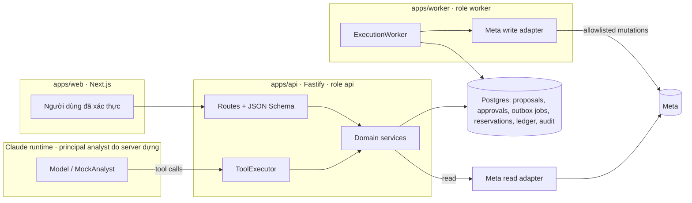

# Kiến trúc tổng quan



- LLM không có write adapter, không có token, không gọi được `approval.decide`.
- API ghi outbox; chỉ worker giữ write adapter. Ở mock mode, `all-in-one` chạy worker cùng process vì fake Meta nằm trong bộ nhớ.
- Chi tiết quyết định: `docs/adr/`.

## ERD (rút gọn từ `packages/domain/migrations/001_init.sql`)

```mermaid
erDiagram
  business_configs { text tenant_id PK; text ad_account_id PK; text version PK; jsonb data }
  proposals { text tenant_id PK; text proposal_id PK; int revision PK; text ad_account_id; text status; char payload_hash; jsonb data }
  policy_results { text tenant_id PK; text proposal_id PK; int revision PK; jsonb data }
  approvals { text approval_id PK; text proposal_id; int revision; jsonb data }
  jobs { text job_id PK; text proposal_id; text kind; text status; timestamptz lease_until; int attempts }
  reservations { text reservation_id PK; text proposal_id; bigint daily_minor; bigint lifetime_minor; text status }
  locks { text scope PK; text holder; bigint token; timestamptz expires_at }
  execution_attempts { text attempt_id PK; char idempotency_key UK; text action_id; text status; jsonb data }
  local_refs { text proposal_id PK; text local_ref PK; text remote_id }
  receipts { text proposal_id PK; int revision PK; jsonb data }
  audit_heads { text tenant_id PK; bigint sequence; char event_hash }
  audit_events { text tenant_id PK; bigint sequence PK; text correlation_id; char event_hash; jsonb data }
  freeze_state { text tenant_id PK; jsonb data }
  incidents { text tenant_id PK; text incident_id PK; jsonb data }
  snapshots { text tenant_id PK; text snapshot_id PK; jsonb data }
  creative_assets { text tenant_id PK; text asset_id PK; jsonb data }
  creative_reviews { text tenant_id PK; text review_id PK; jsonb data }
  entity_changes { bigserial id PK; text entity_id; text proposal_id; timestamptz changed_at }
  verified_entities { text entity_id PK; text proposal_id; timestamptz verified_at }
  sessions { char token_hash PK; text tenant_id; jsonb principal; timestamptz expires_at }
  proposals ||--o| policy_results : "đánh giá"
  proposals ||--o{ approvals : "được duyệt"
  proposals ||--o{ jobs : "outbox"
  proposals ||--o{ reservations : "giữ ngân sách"
  proposals ||--o{ execution_attempts : "ledger"
  proposals ||--o{ local_refs : "map local→remote"
  proposals ||--o| receipts : "kết quả"
  audit_heads ||--o{ audit_events : "chuỗi hash"
```

Mọi bảng đều có `tenant_id` trong khóa hoặc cột. `prev_hash` nằm trong `data` của `audit_events`; `audit_events` có trigger chặn UPDATE/DELETE (append-only ở mức DB).
